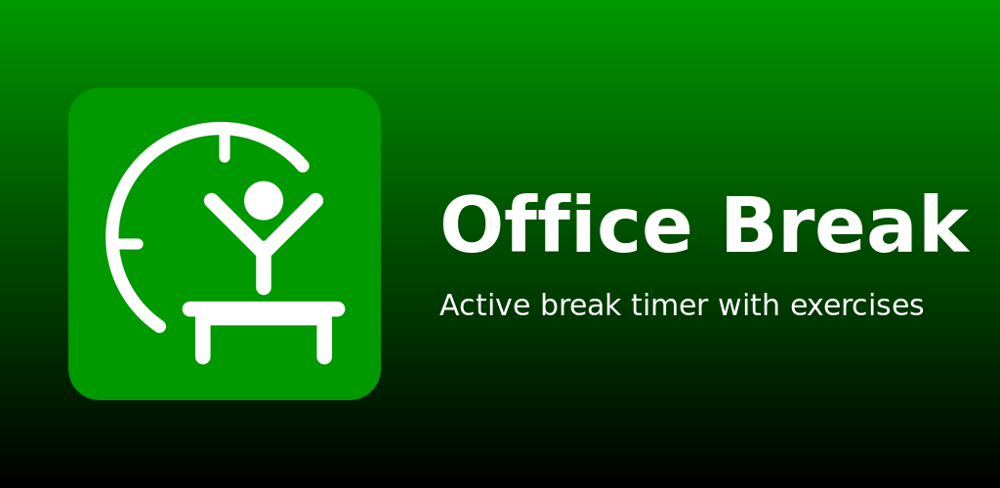
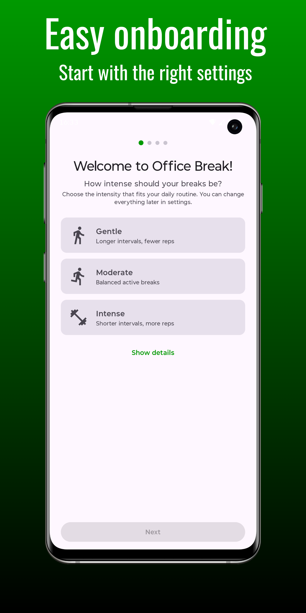
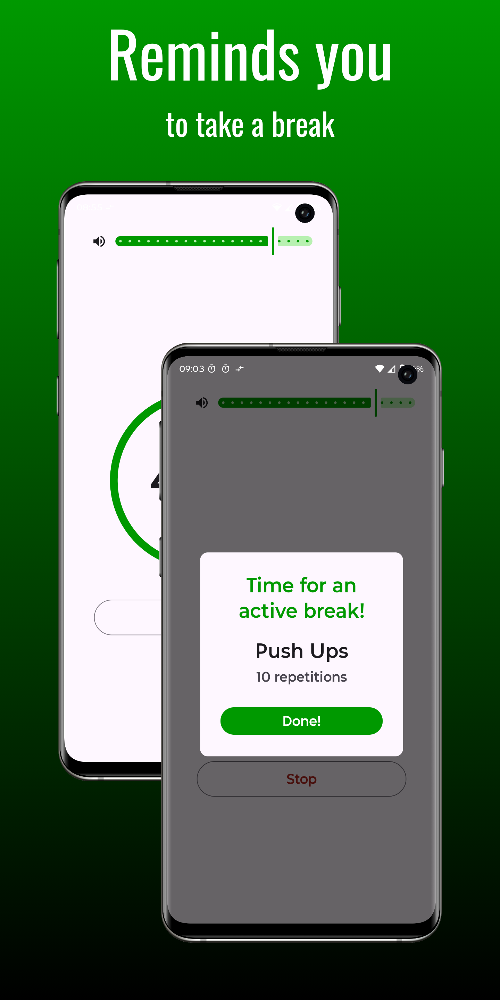
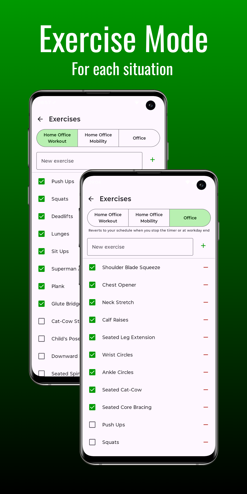

# ⏱️ MoveBreak

<p align="center">
  
</p>

**MoveBreak** is an Android app for regular movement breaks at the office. Set a timer, start it, and get a random exercise when it expires. After confirming, the timer restarts automatically — endlessly, until you manually reset.

[](https://developer.android.com)
[](https://kotlinlang.org)
[](https://developer.android.com/compose)
[](LICENSE.md)

---

## 📱 Screenshots

<p align="center">
  
  
  
</p>

## ✨ Features

- Adjustable timer duration (hours + minutes) via sliders or manual input
- Configurable repetition range (min/max) with linkable sliders for fixed or randomized reps
- Circular countdown display
- Shuffle-bag exercise selection — cycles through all enabled exercises before repeating, persisted across app restarts
- Auto-restart after exercise confirmation (configurable — can be disabled)
- Foreground service with persistent notification (stays visible until manual reset)
- Audible beep alert on timer expiry with configurable beep count (1-5) and custom notification sound support
- Vibration alert on timer expiry
- Lock screen notification with screen wake-up on timer expiry
- TTS break announcements — exercise names read aloud via text-to-speech (localized)
- Work schedule — per-day start/end times, break pause with auto-pause/resume, time inheritance via link icon, weekend/off-day detection, night shift support
- Per-day exercise mode — optional master toggle binds a default mode (Workout / Mobility / Office) to each weekday, link-inherited from the first unlinked day; today's mode is applied automatically on app foreground, onboarding finish, schedule edits, and toggle-on
- One-day mode override — manually picking a mode in the exercise settings stores a transient override for today only; cleared automatically on timer Stop, end-of-shift, or day rollover
- End-of-shift screen — friendly "Enjoy your time off" notification when work hours end
- Break pause screen — "Enjoy your break" screen during scheduled breaks with auto-resume info
- Freestyle mode — automatically detected when starting outside work hours; disables auto-stop and break pausing so the timer runs freely for after-work use
- Custom notification sounds — pick audio files via SAF, preview before saving, reset to default
- Persistent volume bar at top of timer screen
- Home screen widget (Glance) — today's break count, current streak, live second-by-second countdown, and a Start button that launches a break directly from the home screen
- Exercise context modes — three switchable presets with instant mode switching; 25 built-in exercises across all modes
- Exercise management (add, remove, enable/disable per mode)
- Achievements system with unlockable milestones and share-to-social (image card via share sheet)
- Stats tracking — weekly reps, week-over-week comparison, most frequent exercise (all data stored locally)
- Fitness levels with progression
- Dynamic difficulty increase with adaptive threshold (optional)
- Data export and import via JSON backup (SAF integration)
- Privacy policy link in Settings
- Toggle in Settings to disable Android Auto Backup to Google Drive
- Onboarding flow for first-time users
- Theme switcher (System, Light, Dark)
- Language switcher (German, English, System)
- Keep screen on during countdown (optional)
- Material 3 theming

## 🧘 Exercise Modes

Three context-aware modes, each with curated default exercises. All 25 exercises are always visible; switching modes toggles which are enabled. Users can customize each mode independently.

### Home Office Workout
Push Ups, Squats, Deadlifts, Lunges, Sit Ups, Superman Angels, Plank, Glute Bridge

### Home Office Mobility
Cat-Cow Stretch, Child's Pose, Downward Dog, Seated Spinal Twist, Hip Circles, Standing Forward Fold, Thread the Needle, Pigeon Stretch

### Office
Shoulder Blade Squeeze, Chest Opener, Neck Stretch, Calf Raises, Seated Leg Extension, Wrist Circles, Ankle Circles, Seated Cat-Cow, Seated Core Bracing

## 🛠 Tech Stack

- **Kotlin 2.2.10**
- **Jetpack Compose + Material 3**
- **Jetpack Glance** (home screen widget)
- **Jetpack DataStore** (Preferences)
- **kotlinx.serialization** & **kotlinx.coroutines**
- Min SDK 28 (Android 9), Target SDK 36 (Android 16)

## 🚀 Build from Source

```bash
./gradlew assembleDebug                # default (fdroid flavor)
./gradlew assembleFdroidDebug          # explicit F-Droid-style build
./gradlew assembleGplayDebug           # Google Play-style build
```

The app has two product flavors:

- **`fdroid`** (default) — Android Auto Backup disabled, fully privacy-strict.
- **`gplay`** — Android Auto Backup enabled (settings sync to Google Drive); user-toggleable from Settings.

Both flavors share the same `applicationId` (`de.mysportsmate.officebreak`).

### Release Build

```bash
./gradlew assembleFdroidRelease        # signed APK for releases
./gradlew bundleGplayRelease           # signed AAB for Google Play
```

Signed release builds require a `keystore.properties` file in the repo root (git-ignored).

### Run Tests

```bash
./gradlew test                         # all flavors
./gradlew testFdroidDebugUnitTest      # fdroid only
./gradlew testGplayDebugUnitTest       # gplay only
```

### Lint

```bash
./gradlew lint                                    # default variant (fdroid)
./gradlew lintFdroidDebug lintGplayDebug          # both flavors
```

### Install a local debug build

```bash
adb install app/build/outputs/apk/fdroid/debug/app-fdroid-debug.apk
# or
adb install app/build/outputs/apk/gplay/debug/app-gplay-debug.apk
```

## 📂 Project Structure

```
app/src/main/kotlin/de/mysportsmate/officebreak/
├── data/             # Exercises, stats, achievements, backup, settings
├── service/          # Timer service, work schedule, notifications
├── widget/           # Glance home-screen widget
├── tts/              # Break announcements
├── ui/               # Compose screens & components
└── theme/            # Material 3 theming
```

## 🤝 Contributing

Contributions are welcome! Please see [CONTRIBUTING.md](CONTRIBUTING.md) for guidelines.

## ☕ Support

If this project helps you, please consider supporting my work:

<p align="center">
  <a href="https://buymeacoffee.com/awaisdev572">
    
  </a>
</p>

Or [become a supporter on Buy Me a Coffee](https://buymeacoffee.com/awaisdev572) 💛

## 🔒 Security

To report a security vulnerability, please see [SECURITY.md](SECURITY.md).

## 📄 License

This project is licensed under the [GNU General Public License v3.0](LICENSE.md).

> **Attribution note:** MoveBreak is an open-source (GPLv3) edition of the *Office Break* app. While the GPL v3 allows free use, modification, and redistribution, please don't publish rebranded or minimally modified versions of this app on Google Play or other app stores. If you'd like to improve the app, consider contributing back instead.
